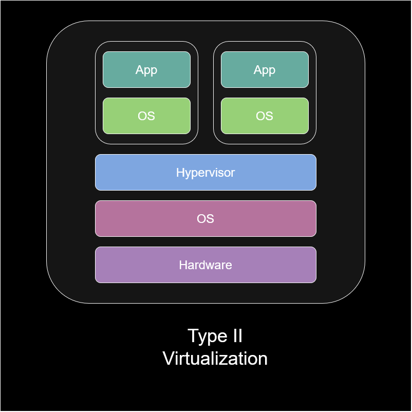

## Overview
The purpose of this lab is simulate setting up and securing a corporate network with various deployed servers and workstations

To accomplish this, I will use Oracle VirtualBox, a type-2 hypervisor that allows users to run multiple guest operating systems simultaneously on the user's host machine. VirtualBox is commonly used for students and IT professional to practice setting up networks, servers, and multi-node systems on a single laptop. Moreover, VirtualBox also allows users to test unverified software and  simulate vulnerable systems inside a disposable virtual machine (VM) that cannot harm the user's real computer.

*Figure 1: Type 2 Hypervisor Diagram*

VirtualBox offers several network modes:
- Not attached: the virtual machine is not connected to the virtual network card that VirtualBox provides
- (Default) NAT: the virtual machine can access the external network using the host's IP address, but external devices cannot directly initate connections to the virtual machine unless you configure port forwarding. Virtual machines configured to use NAT cannot communicate directly with each other.
- NAT Network: similar to NAT, but creates a private network where multiple VMs assigned to the same NAT network can communicate with each other.
- Bridged Adapter: the virtual network card VirtualBox provides is connected directly to the user's physical network card. As a result, the VM receives its own IP address directly from the user's physical router or DHCP server and appears on the user's local network like a real physical computer.
- Internal Network: virtual machines are on a completely isolated network where they can communicate to other VMs on the same internal network, but not with the host machine or outside internet.
- Host-Only Adapter: the host machine and guest VMs are connected on a private network where they can communicate with each other. However, the VMs typically cannot access the external internet.
